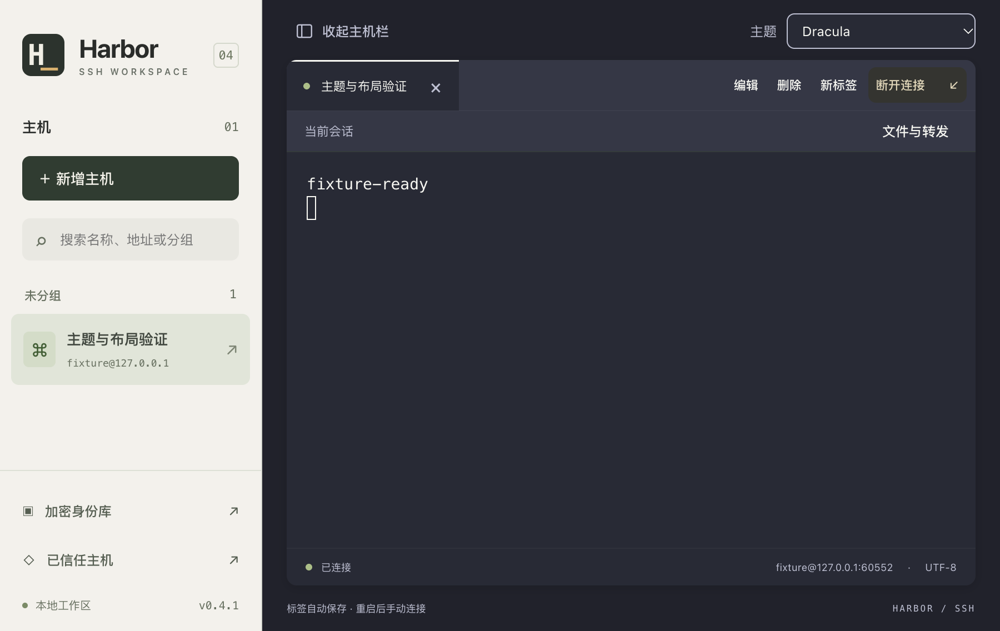
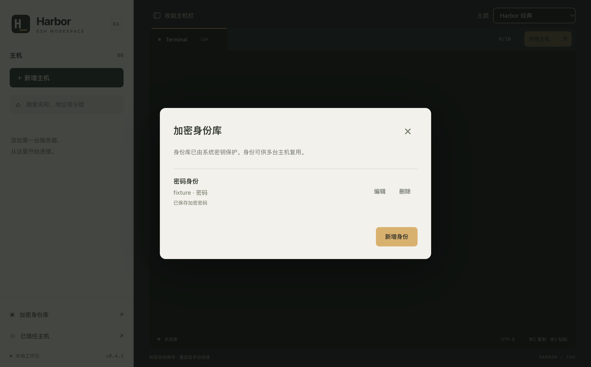
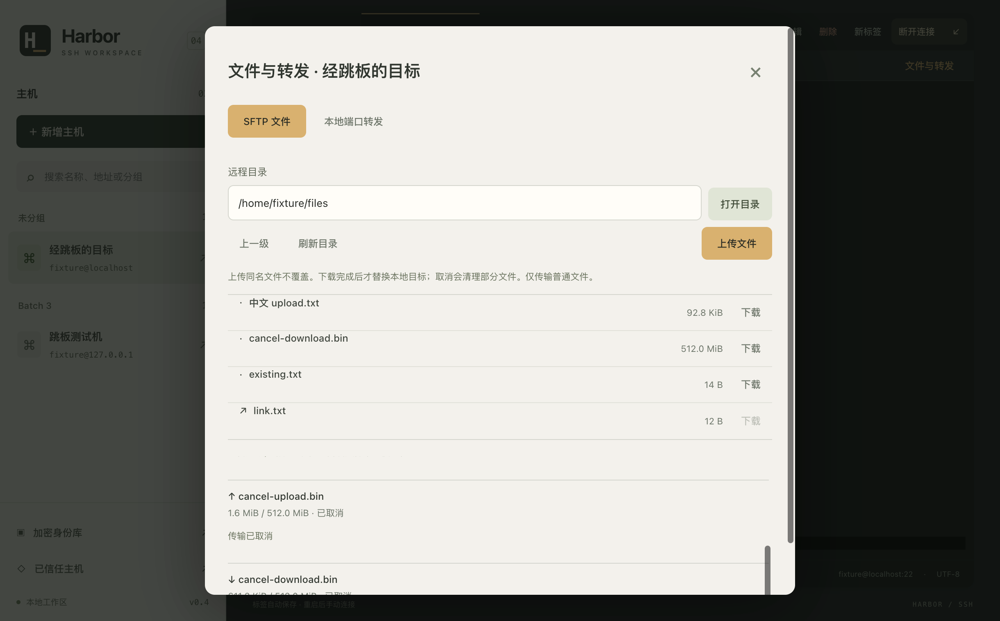

# Harbor SSH

[简体中文](README.md) | English

Harbor SSH is a local SSH desktop client built with Electron, React, TypeScript, ssh2 and xterm.js. It provides tabbed terminals, an encrypted identity vault, SFTP, local port forwarding and single-hop jump hosts. No cloud account or API key is required.

Current source version: **0.4.3**. macOS is the primary development and validation platform. Windows packages are available, but Windows hardware validation is still pending. The application stores its own data and does not import or modify another SSH client's data.

## Interface language

Use the **语言 / Language** selector at the top to switch between **简体中文** and **English**. Chinese remains the default, and your choice is restored after restart. Switching takes effect immediately without disconnecting SSH or clearing the terminal. Host management, the identity vault, authentication, trust prompts, SFTP, forwarding, menus and application error messages support English.

Host names, groups, file names, remote terminal output and server authentication prompts stay unchanged. Native file picker buttons follow the operating system language; application-provided titles follow the selected language.

Validation: `npm run typecheck`, `npm test`, and `npm run test:i18n`. Translations live in `locales/en.ts`, keyed by Chinese source messages, with `{0}` and `{1}` placeholders. Add translations when introducing new messages.

## Screenshots

These are real screenshots from a local test environment with example accounts and files. The interface shows v0.4.1 and is in Chinese; see the download section for the current release version.

**Hosts and SSH terminal:** select a host in the sidebar and work in the terminal. This screenshot uses the Dracula theme.



<details>
<summary>More screenshots: identity vault and SFTP</summary>

**Encrypted identity vault:** manage reusable authentication identities and see their saved status without displaying plaintext passwords.



**SFTP file manager:** browse remote directories, upload or download files, and inspect transfer status. The screenshot includes cancelled test transfers.



</details>

## Download and install

[Latest release](https://github.com/miketam/harbor-ssh/releases/latest) · [v0.4.3 release notes](https://github.com/miketam/harbor-ssh/releases/tag/v0.4.3) · [SHA256SUMS](https://github.com/miketam/harbor-ssh/releases/download/v0.4.3/SHA256SUMS)

These links are pinned to v0.4.3. Check the latest release page for future versions.

| Device | Recommended download | Alternative |
|---|---|---|
| Apple M-series Mac (Apple Silicon) | [arm64 DMG](https://github.com/miketam/harbor-ssh/releases/download/v0.4.3/harbor-ssh-0.4.3-mac-arm64.dmg) | [arm64 ZIP](https://github.com/miketam/harbor-ssh/releases/download/v0.4.3/harbor-ssh-0.4.3-mac-arm64.zip) |
| Intel Mac | [x64 DMG](https://github.com/miketam/harbor-ssh/releases/download/v0.4.3/harbor-ssh-0.4.3-mac-x64.dmg) | [x64 ZIP](https://github.com/miketam/harbor-ssh/releases/download/v0.4.3/harbor-ssh-0.4.3-mac-x64.zip) |
| Windows x64 (Intel / AMD) | [EXE installer](https://github.com/miketam/harbor-ssh/releases/download/v0.4.3/harbor-ssh-0.4.3-win-x64-setup.exe) | No native Windows ARM64 installer |

On a Mac, open **Apple menu > About This Mac**: choose arm64 for an Apple M-series chip, or x64 for an Intel processor. macOS 13 or later is required. On Windows, check **Settings > System > About > System type**.

- **Mac:** open the DMG, drag Harbor SSH.app to Applications, then launch it there. For ZIP downloads, extract the archive and move the application to Applications.
- **Windows:** run the installer, select a dedicated folder writable by your user account, and launch Harbor SSH from the Start menu. The default install folder is `%LOCALAPPDATA%\Programs\Harbor SSH`.
- **Upgrade:** quit the previous version and back up application data before installing. Installed applications do not require Node.js.

### Verify your download

Download `SHA256SUMS` and compare the calculated SHA-256 with the entry for your exact filename.

macOS (replace arm64 with x64 for Intel):

```bash
shasum -a 256 harbor-ssh-0.4.3-mac-arm64.dmg
```

Windows PowerShell:

```powershell
Get-FileHash .\harbor-ssh-0.4.3-win-x64-setup.exe -Algorithm SHA256
```

A matching checksum confirms that the file matches the release asset; it is not a security certification.

### macOS security prompts

Mac packages are ad-hoc signed and are **not notarized by Apple**. macOS may block the first launch because it cannot verify the developer. If you have verified the source and checksum and choose to run the application:

1. Move it to Applications, try opening it once, then dismiss the warning.
2. Open **System Settings > Privacy & Security** and find the blocked Harbor SSH notice.
3. Select **Open Anyway**, authenticate if requested, and confirm opening the application.

Stop if macOS reports malware, says the app will damage your computer, or the checksum does not match. For a damaged-app message, download again and verify the file first. If Open Anyway is unavailable, check system or organization restrictions. Do not disable Gatekeeper or SIP, or remove quarantine flags in bulk. See [Apple's instructions](https://support.apple.com/102445).

### Windows security prompts

The Windows installer is **unsigned**. SmartScreen may show an unknown publisher or “Windows protected your PC.” After verifying the source, checksum and filename, you can choose **More info > Run anyway** in an ordinary unrecognized-app prompt, if that option is available.

If Defender detects malware, or Smart App Control or an organization policy blocks execution, stop and contact your administrator. Do not disable antivirus or global security protection. Smart App Control has no per-app bypass. See [Microsoft's SmartScreen guidance](https://learn.microsoft.com/en-us/windows/apps/package-and-deploy/smartscreen-reputation) and [Smart App Control FAQ](https://support.microsoft.com/en-us/windows/security/threat-malware-protection/smart-app-control-frequently-asked-questions).

Windows installation, uninstallation and runtime behavior still need hardware validation. The Intel package passed SSH and UI tests through the compatibility layer on Apple Silicon; testing on an Intel Mac is still pending.

## Features

- Create, edit, group and search hosts, including IPv4, IPv6 and domain names.
- Up to 10 tabs and concurrent connections, with independent terminal and authentication state. Closing a connected tab requires confirmation.
- Password, private-key and multi-round keyboard-interactive authentication, including OTP or MFA questions. Interactive answers are not saved.
- Confirm SHA-256 server fingerprints before authentication. Changed fingerprints block the connection until you verify and remove the old trust entry.
- UTF-8 terminals, copy/paste, PTY resizing, a collapsible host sidebar and six terminal themes. Appearance preferences persist locally.
- Single-hop jump hosts. Both servers authenticate independently and have their fingerprints checked. The target private key is not sent to the jump host. Nested jump chains are not supported.

To connect, add a host, enter its address and username, select an authentication method, and verify the server fingerprint through a trusted channel. Host edits affect the next connection; active sessions keep their original configuration.

## Encrypted identities

Use the identity vault to save passwords, private keys or interactive identities, then assign an identity to a host. Identity contents use AES-256-GCM with a random nonce and identity-bound authenticated data. The data key is protected by Electron safeStorage; macOS uses the system Keychain. There is no plaintext localStorage fallback.

Private keys can be pasted or imported from files up to 64 KiB. Supported formats include OpenSSH Ed25519, traditional RSA PEM, and RSA/EC PKCS#8 PEM, including supported encrypted variants. You can save a passphrase or enter it when connecting. Unsupported key types produce a conversion prompt.

Saved secrets are not returned by identity-read APIs. Editing explicitly keeps, replaces or clears secret fields. A referenced identity cannot be deleted, and identities used by active sessions require disconnection before editing. Updating a shared identity affects other hosts that reference it. Remembered credentials are saved before authentication; correct failed credentials in the vault.

If system key protection or the protected key file is unavailable, the app preserves existing data and reports that the vault is unavailable. Restore the key file and system access before retrying unlock. Temporary authentication that does not need the vault remains available.

## SFTP and local forwarding

Open the files and forwarding panel after connecting. Operations reuse that tab's verified SSH connection.

- Browse directories and upload or download regular files with progress and cancellation. Up to three transfers can run per session.
- Uploads create files exclusively and do not overwrite existing names. Failed or cancelled uploads attempt to remove their partial files; connection loss or server permissions can prevent cleanup.
- Downloads use a temporary file in the destination directory and replace the selected target only after success. Downloaded content is not additionally encrypted on disk.
- No recursive directory transfer, direct symlink download, remote editing, rename/delete operations or resumable transfers. Directories over 10,000 entries are rejected.
- Local forwarding binds only to `127.0.0.1`. Use port `0` to select a free port. Each session supports up to 10 forwards; the SSH server resolves and reaches the destination.

Disconnecting, closing a tab, reloading or quitting terminates its transfers and forwards. Crashes or network failures can leave partial files. Transfers and forwards are not restored automatically.

## Data, backups and upgrades

Data locations:

- macOS: `~/Library/Application Support/Harbor SSH`
- Windows: `%APPDATA%\Harbor SSH`

The directory contains `harbor.sqlite`, the protected data key `vault-key.bin`, and versioned database migration backups. Host addresses, names, groups, fingerprints and workspace associations are plaintext metadata; identity contents are encrypted. Backing up SQLite alone is insufficient: restoring identities also requires the original protected key file and the corresponding operating-system key protection. Cross-device or cross-OS vault migration is not provided.

Restart restores disconnected tabs and their order. Reconnect manually. Terminal output, temporary credentials and interactive answers are not persisted. Database upgrades from schema v1/v2 to v3 create versioned backups before transactional migration. Do not let an older version write to a newer database; use the appropriate pre-upgrade backup in a separate directory. SQLite free pages are not guaranteed to have historical secrets erased.

On Windows, reuse your install directory when upgrading. Choosing a different folder does not remove the old installation. Uninstall removes shipped application files but preserves application data and unrelated files. The install folder does not change the data location.

Detailed packaging and backup notes: [PACKAGING.md](PACKAGING.md) (Chinese).

## Security boundaries

The renderer uses sandboxing and context isolation with Node integration disabled. Preload exposes fixed APIs, and IPC checks the local top-level frame. Secrets enter client memory during authentication; JavaScript cannot guarantee erasure of every string copy. Remote HTML is not loaded, OSC 52 clipboard writes are disabled, and terminal logs are not saved. Signing changes may cause new system key-access prompts.

Cloud synchronization, multiple jump hops, remote/dynamic forwarding, hardware keys, a key-rotation UI and automatic updates are not included.

## Development and validation

Use Node.js 22.12 or later and npm. The primary development platform is macOS; native builds may require Xcode Command Line Tools. Dependencies are pinned in the lockfile, and postinstall rebuilds the SQLite addon for Electron.

```bash
npm ci
npm run dev
```

`dev` builds and launches the app without a hot-reload server. Use `npm start` to launch an existing build. Quit other copies first: development and installed versions share the default data directory.

```bash
npm run typecheck
npm test
npm run test:appearance
npm run test:integration
npm run test:batch2
npm run test:openssh
npm run test:batch3
HARBOR_MAC_ARCH=arm64 npm run package:mac
HARBOR_MAC_ARCH=x64 npm run package:mac
npm run package:win
npm run test:upgrade
```

Run packaging commands sequentially. Windows packaging requires NSIS (`makensis` on PATH, or set `MAKENSIS`). Mac packaging runs on macOS and produces DMG/ZIP files with architecture-specific checksums and manifests.

Tests use isolated `HARBOR_DATA_DIR` profiles and fictional credentials; never substitute production credentials. Key fixtures require `ssh-keygen`. OpenSSH and batch 3 tests require Docker and download an Alpine image. Upgrade tests require a real older application baseline, configured through `HARBOR_PREVIOUS_APP`; a fresh clone does not contain it. Core crypto tests inject a test protector, while native Keychain tests use Electron safeStorage. Test results in `test-artifacts/` are excluded from Git.

## Project layout

- `electron/store.ts`: database migrations, hosts, fingerprints, encrypted identities and workspace storage.
- `electron/vault.ts`, `identities.ts`: key protection, encryption and identity handling.
- `electron/main.ts`, `preload.ts`: IPC, imports and session lifecycle.
- `electron/ssh.ts`, `ssh-worker.ts`: authentication, jump hosts and terminal sessions.
- `electron/resources.ts`: SFTP and local forwarding.
- `src/`: React interface and terminal components.
- `shared.ts`: IPC types; `tests/` and `scripts/`: fixtures, validation and packaging.

## Contributing

Include the OS, app version, reproduction steps and expected behavior in issues. Remove credentials, private keys, tokens and internal server details from logs and screenshots. Run type checks and core tests before submitting code, and include platform or UI validation for relevant changes. Do not commit local profiles, release artifacts or credentials.

## License

Harbor SSH's own code is licensed under the [MIT License](LICENSE). Retain the copyright and permission notices when using, modifying or distributing it.

Third-party components retain their own licenses. See [THIRD_PARTY_NOTICES.md](THIRD_PARTY_NOTICES.md) and the [dependency license review](DEPENDENCY_LICENSES.md) (Chinese).
